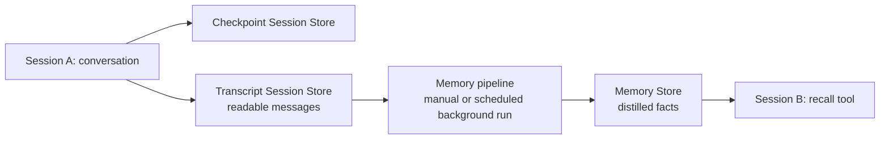

# 02 · Agent memory: sessions → distillation → recall

Demonstrate **short-term memory** within a conversation and **long-term memory** extracted asynchronously from conversations by a managed memory pipeline. The deployed LangGraph agent uses a managed Session Store for checkpoints and a managed Memory Store for searchable facts. A separate pipeline distills the recorded transcripts; it runs on demand or automatically about every 24 hours.

The default `MEMORY_WRITE_MODE=pipeline` exposes only `recall` and `list_memories`. The agent cannot write facts directly, so the demo can attribute new facts to distillation. `MEMORY_AUTO_RECALL=false` keeps retrieval visible as tool calls. A local UTC clock tool is also available.

## Demo story and value

**The story:** an agent continues a conversation, learns a durable preference in the background,
and applies it in a new conversation without the user repeating it. Show **history → pipeline →
saved knowledge → useful answer**, inspecting the real records and tool results at each step.

| Memory capability | Value to explain | Evidence to show |
| --- | --- | --- |
| Managed session persistence | Users continue the same conversation without restating its context. | A follow-up uses earlier facts; reopening A restores history. |
| Explicit Session Store / Memory Store APIs | Applications can provision and inspect history and derived knowledge as separate resources. | Fresh-store CLI responses and the three store roles in the lifecycle section. The pipeline connects existing stores; it does not create the Memory Store. |
| Automated pipeline extraction | Durable knowledge can be captured without the agent calling a save tool on every relevant turn. | Default mode has no `remember`; new facts appear only after a successful extraction run. |
| Scheduled or on-demand distillation | Extraction runs outside the chat request; a presenter can trigger it deterministically and poll the same asynchronous run. | Scheduled policy, manual run ID, and `RUNNING` → `SUCCEEDED`. A configured schedule alone is not evidence that a scheduled run executed. |
| Selective cross-session retrieval | The agent can find prior preferences when relevant and use them to personalize a new task. | B asks a natural question, calls `recall`, receives saved content, and applies the preference. Inspect actual calls; selection is model-dependent. |
| Separate temporary context and durable knowledge | A conversation can retain details that should not become a lasting preference. | The temporary branch remains in A but is absent from the inspected Memory Store after extraction. |

Use the [browser presenter script](#presenter-script-exact-questions-and-evidence) with a terminal
beside it. To demonstrate provisioning too, begin with [fresh resource creation](#record-the-full-lifecycle-from-fresh-resources).
The existing-resource walkthrough demonstrates reuse, not fresh creation. The UI session and
Memory panes already come from the template; this sample wires managed history, readable transcript
capture, pipeline-only extraction, and retrieval into that experience.

Keep claims proportional to the evidence: this demonstrates capability, not measured quality/cost
improvements or production scalability. Conversation-level transcript organization, identity,
retention, and retrieval efficiency still need the production work described below.

## Agent tools and demo mode

| Agent tool | Default pipeline mode | Purpose |
| --- | --- | --- |
| `recall(query, session_id=None)` | Available when the Memory Store is bound. | Search the actor's saved facts across conversations; an optional session filter limits the search. |
| `list_memories(session_id=None)` | Available when the Memory Store is bound. | List stored paths, session labels, and fact counts. |
| `remember(fact, topic)` | Hidden. Enable with `MEMORY_WRITE_MODE=tools`. | Immediately append an explicitly requested durable fact under a topic. |
| `forget(fact, topic, session_id=None)` | Hidden. Enable with `MEMORY_WRITE_MODE=tools`. | Remove a matching stored fact; it does not erase conversation transcripts. |

Actor identity is captured by application code, not supplied as a model tool argument. Without a
resolved Memory Store binding, none of these memory tools are offered. `get_current_time` is a
separate local tool, not a memory tool. Short-term conversation continuity comes from the LangGraph
checkpointer, not from `recall`. Pipeline create/run/status are presenter CLI/API operations; the
agent has no tool to start a pipeline.

The model chooses tool calls during its graph run. Users do not need to name the tool. Some
validated demo prompts explicitly request recall to make the retrieval path easier to inspect.
`MEMORY_AUTO_RECALL=false` means there is no automatic pre-run search.

| Workflow moment | Mechanism or tool actually used |
| --- | --- |
| Session A: state a preference | The checkpointer preserves context and the adapter records readable transcript messages. No memory-writing tool runs. |
| Session A: ask a follow-up | The checkpointer restores the same conversation; no long-term memory tool is required. |
| Presenter triggers distillation | CLI/API starts the pipeline, which reads transcripts and writes the Memory Store. This is not an agent tool call. |
| Fresh session B: ask for saved preferences | The model calls `recall`, receives matching facts, then uses them in its answer. |
| Ask the agent what is stored | The model can call `list_memories`. The equivalent presenter inspection uses CLI `memory entries list`; that CLI call is not an agent tool call. |
| Optional explicit-write segment | In `tools` mode only, `remember` saves an explicitly requested fact immediately and `forget` removes a matching fact on request. |

For an optional agent-tool inspection after distillation, ask: “Use list_memories to show my stored
memory paths and fact counts.” Inspect the actual tool event; listing is not required before recall.

Keep pipeline mode for the main demonstration: no `remember` call can explain the new saved fact,
so a successful pipeline run followed by fresh-session recall demonstrates distillation. To show
immediate explicit memory writes as a separate segment, change `MEMORY_WRITE_MODE` to `tools` in
the deployment source's `app.yaml`, redeploy that source, and inspect actual tool results.

## Tool-driven versus automatic behavior

The installed AgentKit 0.7.0 `recall` description is:

> Search the user's long-term memory for facts relevant to the query.

Its arguments are `query: str` and optional `session_id: str | None`. The model sees that description,
the argument schema, and the system instruction in [agent/agent.py](agent/agent.py): use recall for
durable preferences from earlier conversations. It may generate a structured tool call based on a
natural question such as “What example style do I prefer for project Cedar?” The tool node executes
the call, and the model receives its result before answering. No keyword rule or first-turn rule
forces that decision. “Use recall” is a demonstration aid, not a requirement or a guarantee.

Both retrieval paths call the managed Memory Store's hybrid keyword/semantic search with a limit of
five entries for the trusted actor. The tool uses the model-generated query and an optional session
filter. Automatic retrieval uses user text in the incoming request and adds returned facts to the
system prompt before the first model call of that request. It runs again on later requests, rather
than on every model/tool iteration within a request. Top-five retrieval does not guarantee relevant
facts exist or that the model uses them correctly.

| Capability | When application-managed automation fits | When agent tools fit |
| --- | --- | --- |
| Conversation persistence | Always capture graph state through the configured checkpointer; the model should not decide whether to preserve a turn. | No session-save tool is needed. |
| Transcript recording | The completion hook records readable turns for extraction. | No transcript-recording tool is needed. |
| Memory retrieval | Pre-run search when relevant prior context should be attempted consistently, including the first turn. It adds a search even for requests that may not need memory. | Selective search, refined queries, and follow-up lookup during reasoning. The model can skip retrieval, so evaluate whether it calls recall when needed. |
| Immediate fact changes | An application workflow can explicitly own writes when required. | Optional remember/forget tools support immediate user-requested changes, subject to successful API results and exact-fact matching. |
| Distillation/maintenance | A scheduled or manually triggered pipeline extracts/consolidates facts outside the chat request. | This sample exposes no pipeline-management tool to the model. |

`MEMORY_WRITE_MODE` and `MEMORY_AUTO_RECALL` are independent. The first selects read-only memory tools
versus all four tools; the second controls an additional application search. Enabling automatic
recall does not remove the model's recall tool, and both paths may search in one request. There is
currently no configuration flag for disabling only model-driven recall while keeping automatic
retrieval; that requires changing tool selection. Before enabling both, review whether the model
needs additional searches when supplied context already answers the question.

**Current mode remains unchanged:** pipeline writes, model-driven recall, automatic recall off.
We are comparing choices, not silently enabling another retrieval mode. Automatic pre-run retrieval
has offline boundary tests but has not been demonstrated end to end in the deployed App. It has no
dedicated retrieval event/span in this sample; a search failure currently propagates rather than
falling back silently. Instrument and validate that path before presenting it as a visible feature.

For an unhinted tool-selection demo after distillation, ask the natural question above, then inspect
for an assistant tool call named `recall` and its corresponding tool result. If it answers without a
call, that turn does not demonstrate memory retrieval. Report what happened; a second explicit
“Use recall…” prompt is a separate tool-execution demonstration, not proof of natural tool selection.
The original pipeline validation used an explicit recall request. A later live spot check used
four natural prompts in fresh sessions: all three memory-related prompts triggered recall, and an
unrelated arithmetic prompt used no tool. See [the recorded cases](validation/natural-memory-2026-10-27.json).
This checks one run per prompt on a small dataset, not general selection reliability. Scripted
offline models test graph execution, not an LLM's selection quality.

The official [existing-agent tutorial, Step 5](https://docs.databricks.com/aws/en/agents/agent-memory/existing-agent-tutorial#step-5-give-the-agent-memory)
documents both patterns and permits combining them. The [MemCurrent design discussion](https://www.databricks.com/blog/memcurrent-designing-persistent-memory-production-agents)
explains their tradeoffs, and the [memory retrieval reference](https://docs.databricks.com/aws/en/agents/agent-memory/managed-memory#limitations)
describes hybrid ranking. Neither source implies that every user must explicitly name a memory tool.

## Choose one execution path

Before either path: use Python 3.11+, uv, Databricks CLI, Bash/Zsh, and an authenticated target profile.
Fresh setup also needs `rsync`; the terminal chat examples use `uuidgen` (included on macOS; install
an equivalent UUID utility on other systems). From the repository root:

```bash
cd pro-code/02-agent-memory
export DEMO_PROFILE=ml-demos  # Replace if using another workspace.
databricks auth profiles
uv sync --frozen
uv run --frozen agentbricks doctor .
uv run --frozen pytest -q
```

The target workspace needs Apps, managed stores, serverless compute, model access, and permission to
create resources. The pipeline creator needs access to both pipeline stores and permission to create
tables in the memory store's database. App identity is granted its own store access during setup.

| Goal | Read in this order |
| --- | --- |
| Show every creation step on camera | **Record the full lifecycle from fresh resources** → **Present the demo**. Preserve the exported variables; skip the reusable setup and pipeline-create sections in between. |
| Reuse the validated resources in ml-demos | Export the identifiers below, check/start the existing App, then use **Present the demo**. Do not rerun create commands. |
| Deploy using the fixed sample names in another workspace | **Prerequisites and deployment** → **Configure automated distillation once** → **Present the demo**. |

For the existing validated ml-demos deployment only:

```bash
export DEMO_APP=agent-bricks-agent-memory
export DEMO_SESSION_STORE=agent-memory-demo-sessions
export DEMO_TRANSCRIPT_STORE=agent-memory-demo-transcripts
export DEMO_MEMORY_STORE=memory-stores/agent-memory-demo-memory
export DEMO_PIPELINE=memory-pipelines/22fb18be-a9c3-402e-86a3-8d5d688386d9
uv run --frozen agentbricks --profile "$DEMO_PROFILE" deployments get "$DEMO_APP"
# Run if compute is stopped; starts the existing App rather than redeploying it.
uv run --frozen agentbricks --profile "$DEMO_PROFILE" deployments start "$DEMO_APP"
```

Read the returned status/URL and wait for readiness before invoking. The existing memory contains
our validation facts; use a different project name and inspect baseline memory before rehearsing.
Pipeline polling itself does not require running App compute.



**Resource creation and memory creation are separate:** create the empty stores first (checkpoint sessions, readable transcripts, and memory), then connect them with a pipeline. The pipeline creates and maintains memory *entries*; it does not create the Memory Store. Runtime Store tracks invocation execution and is separate from both.

## Record the full lifecycle from fresh resources

The checked-in validation used stores and a pipeline created during setup. To show resource creation
on camera, use a fresh deployment/store namespace in a temporary source copy; reusing the validated
names demonstrates reuse, not creation. Authentication, permissions, model access, and dependency
installation can be prepared beforehand, but identify those as prerequisites.

From this sample directory, prepare a source copy and short unique names (Bash/Zsh, `rsync` required):

```bash
export DEMO_PROFILE=ml-demos
export DEMO_NAME="mem-$(date -u +%m%d%H%M)"
export DEMO_APP="agent-bricks-$DEMO_NAME"
export DEMO_SESSION_STORE="$DEMO_NAME-sessions"
export DEMO_TRANSCRIPT_STORE="$DEMO_NAME-transcripts"
export DEMO_MEMORY_NAME="$DEMO_NAME-memory"
export DEMO_SOURCE="$(mktemp -d)/$DEMO_NAME"
mkdir -p "$DEMO_SOURCE"
rsync -a --exclude .venv --exclude .env --exclude .agentbricks \
  --exclude __pycache__ --exclude .pytest_cache ./ "$DEMO_SOURCE/"
mkdir -p "$DEMO_SOURCE/.agentbricks"
cp .agentbricks/project.toml "$DEMO_SOURCE/.agentbricks/project.toml"
```

Bind the new names in that copy (these binding commands edit configuration, not create stores):

```bash
uv run --frozen agentbricks sessions bind "$DEMO_SESSION_STORE" --source "$DEMO_SOURCE"
uv run --frozen agentbricks memory bind "$DEMO_MEMORY_NAME" --source "$DEMO_SOURCE"
uv run --frozen agentbricks tracing bind \
  --experiment-name "/Shared/agentbricks_traces/$DEMO_NAME" --source "$DEMO_SOURCE"
cat > "$DEMO_SOURCE/app.yaml" <<APP_CONFIG
command: ["uv", "run", "start-server"]
env:
  - name: MEMORY_WRITE_MODE
    value: pipeline
  - name: MEMORY_AUTO_RECALL
    value: "false"
  - name: AGENT_TRANSCRIPT_STORE
    value: "$DEMO_TRANSCRIPT_STORE"
APP_CONFIG
```

Show the three separate API-backed creations and their real elapsed times:

```bash
time uv run --frozen agentbricks --profile "$DEMO_PROFILE" --output json sessions stores create \
  --name "$DEMO_SESSION_STORE"
time uv run --frozen agentbricks --profile "$DEMO_PROFILE" --output json sessions stores create \
  --name "$DEMO_TRANSCRIPT_STORE"
time uv run --frozen agentbricks --profile "$DEMO_PROFILE" --output json memory stores create \
  --display-name "$DEMO_MEMORY_NAME"
export DEMO_MEMORY_STORE='memory-stores/<copy-the-actual-returned-id>'
```

Each command provisions a store and its backing storage through the managed API. Copy the returned
identifiers on screen; do not assume a display name is the resource ID. If a name already exists,
choose another fresh namespace rather than deleting existing data.

Create the pipeline next, showing its returned resource name and scheduled trigger. Creating it
configures the extraction process; the explicit run later demonstrates execution.

```bash
time uv run --frozen agentbricks --profile "$DEMO_PROFILE" --output json memory pipeline create \
  --session-store "$DEMO_TRANSCRIPT_STORE" --memory-store "$DEMO_MEMORY_STORE" \
  --model system.ai.claude-sonnet-4-5 \
  --instructions @resources/memory-instructions.txt --trigger scheduled
export DEMO_PIPELINE='memory-pipelines/<copy-the-actual-returned-id>'
time uv run --frozen agentbricks --profile "$DEMO_PROFILE" deploy "$DEMO_NAME" --source "$DEMO_SOURCE"
uv run --frozen python scripts/grant_transcript_access.py \
  --profile "$DEMO_PROFILE" --app "$DEMO_APP" --store "$DEMO_TRANSCRIPT_STORE"
```

Continue with **Present the demo** below: inspect empty memory, converse in session A, show same-session
recall and persisted transcript, allow more than 60 seconds after the final turn, start/poll the
pipeline, inspect its generated entries, and recall/apply the preference in fresh session B.
Use those 60 seconds to explain the graph and transcript code, and keep pipeline status visible
while discussing extraction instructions. If a recording compresses waiting, label the elapsed time.

| Phase | What timing evidence we have |
| --- | --- |
| Store creation | Fresh-resource rehearsal: checkpoint store **2.90 s**, transcript store **4.18 s**, Memory Store **2.80 s**. |
| Pipeline creation | Fresh scheduled pipeline creation: **3.18 s**. This configures the pipeline; it does not execute distillation. |
| App deployment | Fresh app deployment: **146.52 s**; separate transcript grant **2.09 s**. Future runtime varies. |
| Transcript eligibility | Current tutorial documents a 60-second freshness cutoff before new turns can be processed. |
| Distillation execution | Latest rehearsal observed `RUNNING` → `SUCCEEDED` over **104.44 s**, excluding the freshness wait. See [rehearsal evidence](validation/full-rehearsal-2026-10-27.json); runtime varies. |

This full setup sequence is an alternative to the reusable-resource setup below, not a second setup
pass. It creates persistent resources and an enabled scheduled pipeline when executed. The temporary
source copy does not make those remote resources temporary. List/inspect the created names before
choosing a cleanup policy; stopping App compute does not stop the pipeline's schedule.

## Prerequisites and deployment

Use a Databricks profile with Apps, managed memory/session APIs, serverless compute, an MLflow experiment, and access to `system.ai.claude-sonnet-4-5`. The pipeline creator needs access to both stores, permission to create tables in the memory store's database, and access to its distillation model. Pipeline runs use the creator's identity; chat uses the App identity.

From this directory, choose the profile and deployment name:

```bash
export DEMO_PROFILE=ml-demos
export DEMO_APP=agent-bricks-agent-memory
uv sync --frozen
uv run --frozen agentbricks doctor .
uv run --frozen pytest -q
```

For an API-focused walkthrough, explicitly create the stores declared in `agent.toml` **once**:

```bash
uv run --frozen agentbricks --profile "$DEMO_PROFILE" --output json sessions stores create \
  --name agent-memory-demo-sessions
uv run --frozen agentbricks --profile "$DEMO_PROFILE" --output json sessions stores create \
  --name agent-memory-demo-transcripts
uv run --frozen agentbricks --profile "$DEMO_PROFILE" --output json memory stores create \
  --display-name agent-memory-demo-memory
```

Save the Memory Store's returned `name` as `DEMO_MEMORY_STORE`, for example `memory-stores/<actual-id>`. Use the actual response; display names and resource IDs can differ. If the stores already exist, inspect the intended resources rather than creating duplicates. Alternatively, deployment provisions missing stores itself.

```bash
export DEMO_MEMORY_STORE='memory-stores/<actual-id-from-create>'
export DEMO_SESSION_STORE=agent-memory-demo-sessions
export DEMO_TRANSCRIPT_STORE=agent-memory-demo-transcripts
uv run --frozen agentbricks --profile "$DEMO_PROFILE" deploy agent-memory --source .
databricks apps get "$DEMO_APP" --profile "$DEMO_PROFILE"
```

Deployment reuses the manifest's checkpoint/memory stores, grants the App access, and binds tracing.
The extra transcript store is configured explicitly through `AGENT_TRANSCRIPT_STORE` in `app.yaml`;
create it once as above and grant the App access with the public SDK:

```bash
uv run --frozen python scripts/grant_transcript_access.py \
  --profile "$DEMO_PROFILE" --app "$DEMO_APP" --store "$DEMO_TRANSCRIPT_STORE"
```

Update the store name in `app.yaml` when using a different transcript store. Open the App URL. `agentbricks dev` disables managed memory and uses process-local conversation state; use the deployed App for this demo.

This is a **single-user sandbox**: the server selects `DEMO_ACTOR_ID`, default `agent`, for both sessions and memory. Payloads cannot select another actor. This differs from templates that use the signed-in email. Actor grouping is not a security boundary; authorization is at the store level.

## Configure automated distillation once

Create a pipeline using the **resolved store identifiers**, the existing model, and the checked-in extraction instructions:

```bash
uv run --frozen agentbricks --profile "$DEMO_PROFILE" --output json memory pipeline create \
  --session-store "$DEMO_TRANSCRIPT_STORE" \
  --memory-store "$DEMO_MEMORY_STORE" \
  --model system.ai.claude-sonnet-4-5 \
  --instructions @resources/memory-instructions.txt \
  --trigger scheduled
```

Copy the returned pipeline resource name:

```bash
export DEMO_PIPELINE='memory-pipelines/<actual-pipeline-id>'
uv run --frozen agentbricks --profile "$DEMO_PROFILE" memory pipeline get "$DEMO_PIPELINE"
```

Show `dreamer_policy.trigger=SCHEDULED` and the model/instructions. Scheduling starts runs about every 24 hours, with the first start chosen by the service. It does not trigger after every message or when a browser closes. There is no custom interval/cron setting. Manual runs remain available; only one run can be active per pipeline. Only one pipeline can connect a given store pair. For an existing pipeline, inspect it, then use `memory pipeline update` to change its instructions/model/trigger.

## Monitor from the CLI without a UI

The pipeline APIs work independently of App compute. The chat App must be running for browser/chat
requests, but a stopped App does not prevent listing pipeline runs or polling their status. A backing
job's internal UI link is optional and may not be accessible; use these commands for the demo.

```bash
# Show the pipeline settings, including its configured scheduled trigger.
uv run --frozen agentbricks --profile "$DEMO_PROFILE" memory pipeline get "$DEMO_PIPELINE"

# List existing manual/scheduled runs without starting a new one.
uv run --frozen agentbricks --profile "$DEMO_PROFILE" --output json memory pipeline runs list "$DEMO_PIPELINE"

# Inspect one run. Copy its full name from the list/start response.
uv run --frozen agentbricks --profile "$DEMO_PROFILE" --output json memory pipeline runs get \
  'memory-pipelines/<pipeline-id>/runs/<run-id>'

# Poll the SAME existing run until success, failure, or the monitoring timeout.
uv run --frozen python scripts/pipeline_run.py --profile "$DEMO_PROFILE" \
  --run 'memory-pipelines/<pipeline-id>/runs/<run-id>' --interval 10 --timeout 600
```

`--run` only polls; `--pipeline` starts a new run and then polls it. The helper prints real API JSON:
`RUNNING` while pending/in progress, then `SUCCEEDED`, `FAILED`, or `CANCELLED`. Inspect `error` and
`job_status` when present. A completed run prints its terminal state once and exits immediately.
To demonstrate transitions live, use the new run from the demo, not an already completed run.

After `SUCCEEDED`, use `memory entries list/search` and a fresh chat session to verify extraction
and recall; pipeline status alone does not prove a specific fact was retained. For a terminal-only
presentation, use the invocation API example below, show the transcript with `sessions items list`,
and use the same memory/pipeline commands. No browser is required for that flow.

If the App is stopped, inspect its status and deliberately start the existing deployment when you
want to resume chat (starting compute can incur charges):

```bash
uv run --frozen agentbricks --profile "$DEMO_PROFILE" deployments get "$DEMO_APP"
uv run --frozen agentbricks --profile "$DEMO_PROFILE" deployments start "$DEMO_APP"
```

## Present the demo

Use two windows side by side: **the generated chat UI** for conversations, history, tool calls,
and stored memory; **a terminal** for store creation and asynchronous pipeline triggering/polling.
For a full creation demo, complete **Record the full lifecycle from fresh resources** first and
keep its exported `DEMO_*` values. For a conversation-only demo, reuse the existing resources below.

### Open the chat UI

The pinned Agent Bricks 0.7.0 LangGraph template includes this zero-build browser UI by default
(`--disable-chat-app` opts out). The sample customizes its title and memory guidance. It is served
at the deployed App's root URL; no separate frontend deployment is needed. See [CHAT_APP.md](CHAT_APP.md)
for the UI behavior and [ui/](ui/) / [runtime/ui.py](runtime/ui.py) for its implementation.

For the existing validated deployment, run from `pro-code/02-agent-memory`:

```bash
export DEMO_PROFILE=ml-demos
export DEMO_APP=agent-bricks-agent-memory
export DEMO_MEMORY_STORE=memory-stores/agent-memory-demo-memory
export DEMO_PIPELINE=memory-pipelines/22fb18be-a9c3-402e-86a3-8d5d688386d9
uv run --frozen agentbricks --profile "$DEMO_PROFILE" deployments get "$DEMO_APP"
# Run only when stopped, then wait for readiness before opening the browser.
uv run --frozen agentbricks --profile "$DEMO_PROFILE" deployments start "$DEMO_APP"
```

Open the URL returned by the deployment command. For this existing App it is
[the memory chat UI](https://agent-bricks-agent-memory-7474655512364318.aws.databricksapps.com).
Sign in with access to the Databricks App. Its compute was **STOPPED** when checked on October 28;
the link alone does not start it. For a fresh deployment, use that deployment's returned URL and
resource variables instead of the existing-deployment values above.

| UI control | Use during the demo |
| --- | --- |
| Chat composer and **Foreground** / **Streaming** | Ask the questions below. Foreground shows the complete answer; Streaming shows it as generated. |
| **Sessions → New session** | Create B with a different conversation UUID while keeping the server-selected actor. Copy A's UUID before switching. |
| **Sessions** list / refresh | Click a previous session row to reload its history. A page refresh retains the current UUID; it does not create B. |
| **Memory** capability card | Open the Memory pane, refresh entries, search for the project, and click an entry to inspect its saved content. |
| **Tool request** / **Tool result** chat messages | Show the actual `recall` arguments and returned memory before the answer. |
| **Events** / **Traces** | Inspect invocation details; the Traces link opens the configured MLflow experiment. |

The UI's **Background** option controls asynchronous *chat invocations*. It does not run memory
distillation. This sample has no pipeline-management UI: start and monitor memory pipelines in the
terminal. The Memory pane browses their output. `agentbricks dev` also serves a local UI, but its
local history and disabled managed memory cannot validate this cross-session managed-memory demo.

### What comes with the template, and what this sample adds

Compared directly with the installed Agent Bricks 0.7.0 LangGraph UI overlay:

| Already included in the template | Memory-sample addition or customization |
| --- | --- |
| Chat, model picker, Streaming / Background / Foreground modes | Memory-focused title, explanation, and starter prompts; **Background chat** label distinguishes chat execution from distillation. |
| Session list, new-session creation, history reload | The sample binds a managed checkpoint store so the demo can show durable conversation history. |
| Memory pane, entry search/details, tool request/result display | Pipeline-only memory writes, readable transcript recording, configured extraction instructions, and natural model-selected recall. The pane inspects actual store output. |
| Events and MLflow experiment link | Pipeline run/poll helper and live validation evidence. Pipeline control stays in the terminal. |
| Actor browsing UI | This sample makes the actor field read-only and uses its server-selected single-user demo actor. Production user identity is still an adaptation task. |

We reuse the template's existing browser JavaScript and stylesheet. The sample does not add a
second frontend or a pipeline control panel. Its starter buttons fill the composer without sending:
edit `Willow` to a fresh project label before sending, use the same label in every prompt, and use
starter 3 only after successful distillation and **New session**. Starter buttons appear in the
empty chat view; follow-up questions can be typed or copied from the script below. Sharing a
preference records history; it does not itself prove a Memory Store entry was created.

### Presenter script: exact questions and evidence

Use a fresh project label, such as **Willow-1028a**, and replace it consistently in every question.
Check that this project's preference is absent from the Memory pane first; existing stores contain
previous rehearsals. Keep the default pipeline-write mode and automatic recall off. Select the
validated `system.ai.claude-sonnet-4-5` model for a comparable run.

| Step | Ask or do | What to show / explain |
| --- | --- | --- |
| 1. Baseline | Open **Memory**, refresh, and inspect entries for `Willow-1028a`. Return to chat and click **New session**; note A's UUID. | The new preference is absent. With fresh resources the whole store should be empty; with reused resources only claim this fact is absent. |
| 2. Give A two facts | **“For project Willow-1028a, I prefer concise Python examples. For this chat only, call the temporary test branch amber-42. Acknowledge both briefly.”** | The agent acknowledges both. No `remember` tool is available: this records history, not a direct memory write. |
| 3. Short-term continuity | In A: **“From this conversation, what example style do I prefer for Willow-1028a, and what temporary branch did I mention?”** | The answer uses both facts from A's history. Inspect whether any tools ran; this step should not need long-term memory. |
| 4. Durable history | Refresh the page and reopen A if needed. Inspect **Memory** again before triggering the pipeline. | Chat history remains; the new durable preference should still be absent from Memory unless a scheduled run intervened. |
| 5. Distill outside chat | After the last completed turn, wait at least 65 seconds, then run the pipeline command below in the terminal. | Show its actual run ID and `RUNNING` → `SUCCEEDED`. Explain that a scheduled run uses the same background mechanism; this is an on-demand trigger. |
| 6. Inspect derived memory | Open **Memory → Refresh memory entries**, then inspect the new project entry. | Confirm the saved Python preference and whether `amber-42` was excluded. Paths/wording can vary; inspect actual content. |
| 7. Apply long-term memory in B | Click **New session**. Ask **“I'm writing documentation for project Willow-1028a. Show a function that removes duplicate strings, following my usual example style.”** | B's UUID differs from A's. Show the actual `recall` request/result and whether the answer uses the saved concise-Python preference. The prompt never names the tool. |
| 8. Separate temporary context | In B: **“What was the temporary test-branch name I mentioned in my earlier conversation about Willow-1028a?”** | Inspect any search results. If it was excluded, the agent should report that it lacks the saved name. Do not put `amber-42` into this question. |
| 9. Return to A | Click A's session row. Ask **“What temporary branch did I name earlier in this conversation?”** | A can still answer `amber-42` from its history although the branch was not saved as durable memory. |
| 10. Optional selectivity | In a new session: **“What is 17 multiplied by 19? Just give the number.”** | Inspect actual behavior: the earlier test answered `323` without tools. This is a spot check that memory retrieval can be skipped. |

Step 7's natural task was validated in the fresh-resource rehearsal. Step 8 is an additional
presenter check; do not describe it as a guaranteed outcome. An optional missing-fact question is
**“Which testing framework have I chosen for project Willow-1028a?”** The saved style preference does
not answer that question; check that the agent acknowledges the missing information instead of
inventing a framework. Earlier Cedar spot checks validated this distinction.

**No End session action is required.** Wait for the final answer to finish, then allow the
freshness interval below. **New session** changes the conversation UUID; it does not start a
pipeline. Sharing a fact also does not start one. The configured schedule or an explicit CLI/API
run starts distillation. An agent's acknowledgment is not proof that extraction has happened.

For step 5, run from the sample directory with the selected deployment's variables:

```bash
# Start the wait after the final invocation completes, not when the prompt is submitted.
sleep 65
uv run --frozen python scripts/pipeline_run.py \
  --profile "$DEMO_PROFILE" --pipeline "$DEMO_PIPELINE" --interval 10 --timeout 600
```

Continue to B only after `SUCCEEDED` and inspection of the extracted entry. If natural tool
selection does not call `recall`, report that result; asking **“Use recall to find my saved example
preference for project Willow-1028a.”** is a separate explicit-tool demonstration. The latest
rehearsal selected three recall calls and one list call; exact call counts are not guaranteed and
extra searches are not necessary to prove the feature.

Allow roughly **6–10 minutes for an existing-resource presentation**, including conversation turns,
the 65-second eligibility wait, and variable pipeline execution. Fresh setup additionally includes
resource creation and App deployment; use the measured timings above as observations, not guarantees.
A recording can compress waits if the actual elapsed time is labeled. The fresh-resource rehearsal
and tool results are recorded in [VALIDATION.md](VALIDATION.md).

The model controls wording and extraction: inspect the actual stored content, paths, and tool results instead of assuming an exact sentence/path. A two-turn conversation in one session alone does not prove long-term memory.

```bash
# List content, then search it through the managed memory API.
uv run --frozen agentbricks --profile "$DEMO_PROFILE" --output json memory entries list \
  --store "$DEMO_MEMORY_STORE" --actor-id agent
uv run --frozen agentbricks --profile "$DEMO_PROFILE" --output json memory entries search \
  --store "$DEMO_MEMORY_STORE" --actor-id agent --query 'Cedar example preferences'

# Start exactly one run and monitor that run (default timeout: 10 minutes).
uv run --frozen python scripts/pipeline_run.py \
  --profile "$DEMO_PROFILE" --pipeline "$DEMO_PIPELINE"
```

The command runs from your local terminal, but distillation executes remotely in Databricks. It needs the workspace profile and pipeline ID, not an App name: the pipeline already connects its transcript Session Store to its destination Memory Store. The deployed App writes transcripts; it does not execute the pipeline. Once transcripts are persisted and eligible, distillation does not require the App's compute to be running.

The helper uses the pinned CLI's public `memory pipeline run` and `memory pipeline runs get` commands. It prints real API responses and exits 0 only on `SUCCEEDED`, 1 on failure, and 75 on monitoring timeout. A timeout leaves the remote job running; resume monitoring with `--run <full-run-resource-name>`, rather than starting another run. Pipeline runtime is variable; there is no immediate-completion promise.

### Finish the presentation

Stop the App compute when finished, preserving its stores and conversation history:

```bash
uv run --frozen agentbricks --profile "$DEMO_PROFILE" deployments stop "$DEMO_APP" --yes
uv run --frozen agentbricks --profile "$DEMO_PROFILE" deployments get "$DEMO_APP"
```

Verify `compute_status.state` is `STOPPED`. This stops chat compute; the independently scheduled
memory pipeline remains enabled. Its subsequent runs can still use remote compute. Changing its
schedule is a separate pipeline operation, not a consequence of closing the browser or stopping
an App. The main demo App was stopped after the October 28 browser acceptance walkthrough.

### Complete terminal-only presentation

Use this as an alternative to browser chat after completing either setup path. Keep all exported
`DEMO_*` values in this terminal. Each command is run from the original sample directory, where its
pinned CLI and helper scripts are installed. Choose a fresh project for an existing store.

```bash
export DEMO_PROJECT="Cedar-$(date -u +%H%M%S)"
export DEMO_SESSION_A="$(uuidgen)"
export DEMO_SESSION_B="$(uuidgen)"

# Baseline: inspect content before claiming a new fact is absent.
uv run --frozen agentbricks --profile "$DEMO_PROFILE" --output json memory entries list \
  --store "$DEMO_MEMORY_STORE" --actor-id agent

# First turn: durable preference plus a temporary constraint.
uv run --frozen agentbricks --profile "$DEMO_PROFILE" endpoint invoke "$DEMO_APP" \
  --path /api/invocations \
  --json "{\"id\":\"$(uuidgen)\",\"session_id\":\"$DEMO_SESSION_A\",\"input\":{\"messages\":[{\"role\":\"user\",\"content\":\"For project $DEMO_PROJECT, I prefer concise Python examples. For this chat only, call the temporary test branch amber-42. Acknowledge both briefly.\"}]},\"stream\":false}"

# Follow-up: same session, fresh invocation; neither fact is repeated.
uv run --frozen agentbricks --profile "$DEMO_PROFILE" endpoint invoke "$DEMO_APP" \
  --path /api/invocations \
  --json "{\"id\":\"$(uuidgen)\",\"session_id\":\"$DEMO_SESSION_A\",\"input\":{\"messages\":[{\"role\":\"user\",\"content\":\"From this conversation, what example style do I prefer for $DEMO_PROJECT, and what temporary branch did I mention?\"}]},\"stream\":false}"

# Inspect pipeline-readable transcript sessions. Their metadata.source_session_id links to A.
uv run --frozen agentbricks --profile "$DEMO_PROFILE" --output json sessions list \
  --store "$DEMO_TRANSCRIPT_STORE" --filter 'actor_id = "agent"'
# Copy a returned transcript session ID to inspect its actual messages:
# uv run --frozen agentbricks --profile "$DEMO_PROFILE" --output json sessions items list \
#   --store "$DEMO_TRANSCRIPT_STORE" --session-id 'COPY_TRANSCRIPT_SESSION_ID' --order-by 'create_time asc'

# Confirm the newly stated fact is still absent from memory before distillation.
uv run --frozen agentbricks --profile "$DEMO_PROFILE" --output json memory entries list \
  --store "$DEMO_MEMORY_STORE" --actor-id agent

# Begin AFTER the final invocation returns completed. Explain the code during this wait.
sleep 65

# Start exactly one asynchronous run and poll it.
time uv run --frozen python scripts/pipeline_run.py \
  --profile "$DEMO_PROFILE" --pipeline "$DEMO_PIPELINE" --interval 10 --timeout 600
```

**Continue only if the helper exits 0 and shows `SUCCEEDED`.** On exit 75, resume with `--run` using
the printed full resource name; on failure inspect the actual API error. Do not start another run
just to resume monitoring. The sleep makes a newly completed turn older than the documented
60-second cutoff; it is separate from pipeline execution time.

```bash
# Inspect actual extracted entries and then search for this project's preference.
uv run --frozen agentbricks --profile "$DEMO_PROFILE" --output json memory entries list \
  --store "$DEMO_MEMORY_STORE" --actor-id agent
uv run --frozen agentbricks --profile "$DEMO_PROFILE" --output json memory entries search \
  --store "$DEMO_MEMORY_STORE" --actor-id agent --query "$DEMO_PROJECT example preferences"

# Explicit tool-execution segment, matching prior live validation.
# To assess natural selection instead, first ask the unhinted question described above.
# Fresh conversation: recall and USE the preference; check the temporary fact separately.
uv run --frozen agentbricks --profile "$DEMO_PROFILE" endpoint invoke "$DEMO_APP" \
  --path /api/invocations \
  --json "{\"id\":\"$(uuidgen)\",\"session_id\":\"$DEMO_SESSION_B\",\"input\":{\"messages\":[{\"role\":\"user\",\"content\":\"Use recall to find my saved example preference for project $DEMO_PROJECT, then apply it to a function that removes duplicate strings. Also search memory for the temporary test-branch name; do not invent one.\"}]},\"stream\":false}"
```

Expected evidence: A's follow-up recovers both facts from session history; the pipeline creates an
entry containing the durable preference; B emits a successful `recall` tool result and applies it.
Inspect whether the temporary branch was excluded. An assistant's assertion alone is not proof.
`list_memories` lists paths/counts, while the CLI's JSON entry list shows content for inspection.

There is no session-close API requirement. The invocation API persists a completed turn's readable
transcript before reporting completion. `X-Routing-Key` is only a routing hint; the top-level
`session_id` is the application conversation identity. Forgetting memory does not erase transcripts.

## Repository structure and adaptation

For this demo, follow transcript recording → pipeline instructions → recall, and use the browser only for conversation/history and memory inspection. To adapt it, choose what deserves durable memory, define trusted actor identity, and replace the sample store names before deployment.

| File or directory | Role in this demo | Adapt for your own agent |
| --- | --- | --- |
| [agent/memory.py](agent/memory.py) | Pipeline-only recall/list tools by default; optional pre-run recall. | Choose pipeline or explicit tool writes and whether retrieval runs automatically. |
| [agent/transcript.py](agent/transcript.py) | Readable user/assistant turns in the dedicated transcript store, separate from graph checkpoints. | Review message normalization, retention, transcript-session growth, and replay handling for your workload. |
| [resources/memory-instructions.txt](resources/memory-instructions.txt) | Guides which facts the pipeline retains and consolidates. | Define durable facts, exclusions, corrections, and topic organization; apply edits with pipeline update. |
| [agent/agent.py](agent/agent.py) | Prompt, model, graph, managed checkpointer, and memory-tool integration. | Set domain instructions and model; keep recalled context outside checkpointed input. |
| [runtime/adapter.py](runtime/adapter.py) | Server-selected demo actor, session mapping, and completed-turn transcript recording. | Replace the fixed actor with verified user/tenant context consistently across all state operations. |
| [agent.toml](agent.toml) | Checkpoint/memory bindings and tracing experiment. | Select store names and tracing for your workspace. A pipeline is configured separately. |
| [app.yaml](app.yaml) | Pipeline mode and AGENT_TRANSCRIPT_STORE; deployment adds resolved bindings. | Configure the transcript store and application environment for your deployment. |
| [scripts/grant_transcript_access.py](scripts/grant_transcript_access.py) | Grants the actual App principal access to the extra transcript store. | Run for your selected App/store after setup; review your access model. |
| [scripts/pipeline_run.py](scripts/pipeline_run.py) | Starts one asynchronous run, or polls an existing run with --run. | Use your profile/pipeline IDs and monitoring timeout; existing-run polling starts no new job. |
| [scripts/inspect_state.py](scripts/inspect_state.py) | Reads memory and a specified managed session through AgentKit. | Use to inspect your actor partition and persisted evidence. |
| [runtime/ui.py](runtime/ui.py) | Memory browse/search and session/history routes. | Keep actor and session authorization aligned with your application identity. |
| [ui/](ui/) | Browser conversation, session picker, and memory inspection. | Change presentation and domain examples; pipeline execution is shown through the CLI. |
| [runtime/main.py](runtime/main.py) | DurableAgentServer startup and hooks. | Usually retain; consult the contract for integration changes. |
| [tests/](tests/) | Graph, memory, retrieval-boundary, transcript, local-mode, UI, runtime, and polling checks. | Add your own positive recall, corrections, irrelevant-fact exclusion, and isolation cases. |
| [pyproject.toml](pyproject.toml) | Pinned Agent Bricks environment and project entry point. | Manage dependency changes here; uv.lock is generated by uv. |
| [uv.lock](uv.lock) | Generated lockfile for local frozen commands. | Regenerate with uv after dependency changes. |
| [validation/](validation/) | Generated live test evidence: natural prompts, actual tool calls/results, answers, and trace identifiers. | Use these observed cases as a starting point; rerun against your own model/data. |
| [VALIDATION.md](VALIDATION.md) | Observed workspace resources, successful run, and acceptance evidence. | Record your own deployment results; existing IDs and test memories belong to this workspace. |
| [AGENTKIT_CONTRACT.md](AGENTKIT_CONTRACT.md) | Session/invocation mapping and durable runtime requirements. | Consult before modifying HTTP, identity, or recovery wiring. |

## API and source walkthrough

| Capability | Public API surface used |
| --- | --- |
| Create/browse session state | `AgentKitClient.session_stores.create/get`, store `add/get/list`, session `append_items/list_items`; `/api/2.0/agents/session-stores`. |
| Create/browse/search memory | `AgentKitClient.memory_stores.create/get`, store `list/search`; `/api/2.0/agents/memory-stores`. |
| Configure/start/inspect distillation | `agentbricks memory pipeline create/get/update/run/runs get`; `/api/2.0/agents/memory-pipelines`. |
| Agent conversations | App `/api/invocations`, distinct from the workspace store APIs. |

The managed checkpointer stores opaque LangGraph checkpoint items. `agent/transcript.py` additionally writes to the separate `AGENT_TRANSCRIPT_STORE` a deterministic `transcript-*` session per completed invocation with documented `{type: "message", role, content}` items. `source_session_id` links it back to the chat; `actor_id` groups the actor's turns for the pipeline. The official tutorial records one transcript session per conversation; our per-invocation layout is a custom replay-handling choice that increases session count and fragments conversation context. These transcript sessions are implementation records, not additional browser conversations. A ten-turn chat therefore creates ten readable transcript sessions rather than one. The recommended conversation-level layout appends all turns to one transcript session with a stable conversation ID. It preserves the ordered context for references and corrections, and avoids the extra session records. Moving to that layout requires ordered appends and durable retry deduplication; simply replacing the key with the conversation ID would break the current replay check. Replay checks avoid ordinary duplicate appends; writes are not an exactly-once transaction. Text content blocks that are not strings are currently excluded from distillation.

Pipelines process actors independently, checkpoint progress, and merge/maintain existing memories. They may rewrite, merge, split, or delete entries saved by tools too. Forgetting a stored fact does not erase transcripts, and retained history can supply it to future extraction. Optional direct writes require changing `MEMORY_WRITE_MODE` to `tools` and redeploying; the four tools then support explicit remember/recall/list/forget. That is a separate demonstration from pipeline-only extraction.

## Verification and references

### MemCurrent design choices and scale boundaries

The [MemCurrent design article](https://www.databricks.com/blog/memcurrent-designing-persistent-memory-production-agents)
separates raw episodic history from derived knowledge, and combines explicit online updates with
offline consolidation. This demo follows that separation with separate session/checkpoint and derived-memory storage plus a managed pipeline.
Pipeline-only mode makes the extraction path observable; `MEMORY_WRITE_MODE=tools` enables the
hybrid pattern of immediate explicit updates plus later pipeline consolidation using the same stores.

For a stronger final scene, ask session B: “Use my saved Cedar preference and show a short Python
function that removes duplicate strings.” Inspect both the `recall` result and whether the answer
actually applies the preference. Successful storage alone does not establish useful memory.

The implementation uses managed storage and asynchronous batched extraction, and `recall` retrieves
up to five relevant entries rather than loading all past conversations. Automatic pre-run retrieval
is optional and off by default. The research article's memory index and unified episodic search/fetch
are not exposed by this sample's four tools; do not describe the demo as reproducing every research
component or its benchmark gains.

Before production scale:

- Replace the fixed demo actor with verified application identity consistently in chat, history,
  memory, and pipeline records. Actor filters group data; use separate stores where security
  boundaries require them.
- Add a context-window policy for long conversations. The current graph loads the growing session;
  durable storage does not make model context unlimited.
- Plan retention and monitor transcript growth: the current adapter creates one readable transcript
  session per completed invocation in a separate store from checkpoint sessions. It excludes non-string
  message content and does not make transcript/checkpoint/runtime writes atomic.
- Monitor pipeline status/errors, per-actor progress, retrieval relevance, answer quality, latency,
  and token usage. Managed pipeline concurrency is one run at a time. Current docs also describe an
  actor enumeration limit of 48 KiB of serialized IDs (about 1,200 UUID actors); validate this limit
  before choosing store partitioning for a large deployment.
- Demonstrate corrections and irrelevant/temporary-fact exclusion as well as positive recall.
  Do not promise complete erasure from derived-memory deletion while source transcripts remain.

These are concrete limits of this introductory sample, not a claim of production load validation.

```bash
uv run --frozen agentbricks doctor .
uv run --frozen pytest -q
```

These are offline checks, not proof that a deployed pipeline works. Live acceptance requires an actual successful run, inspection of its generated memory, and recall in a fresh session. See [VALIDATION.md](VALIDATION.md) for the latest observed results.

Verified against the installed Agent Bricks 0.7.0 source (`databricks_agentkit/langgraph/memory.py`, `session_store.py`, and `databricks_agentbricks/cli/pipeline.py`, `databricks_agentkit/_api_client.py`) and official docs:

- [Agent Bricks CLI](https://docs.databricks.com/aws/en/agents/custom-agents/agent-bricks-cli)
- [Launch blog](https://www.databricks.com/blog/introducing-agent-memory-databricks)
- [Agent memory and sessions](https://docs.databricks.com/aws/en/agents/custom-agents/stateful-agents)
- [Existing-agent tutorial, including LangGraph transcripts and the freshness cutoff](https://docs.databricks.com/aws/en/agents/agent-memory/existing-agent-tutorial)
- [Agent sessions](https://docs.databricks.com/aws/en/agents/agent-memory/managed-sessions)
- [Agent memory](https://docs.databricks.com/aws/en/agents/agent-memory/managed-memory)
- [Memory pipelines](https://docs.databricks.com/aws/en/agents/agent-memory/memory-pipelines)
- [Agent Bricks source repository](https://github.com/databricks/databricks-ai-bridge/tree/main/integrations/agentbricks/src)

The docs currently say to monitor runs via REST. The pinned 0.7.0 CLI also implements `memory pipeline runs get`; its help and source are the basis for the helper.
