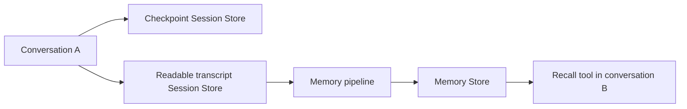

# 02 · Agent memory

Give an agent continuity within a conversation and durable knowledge across conversations.
A memory pipeline extracts useful facts from saved transcripts; the agent can retrieve them later.

| Capability | Why it matters |
| --- | --- |
| Session history | Continue a conversation without repeating context. |
| Background distillation | Extract durable preferences without asking the agent to save every fact. |
| Cross-session recall | Use saved knowledge to personalize a new task. |
| Separate history and memory | Keep temporary chat details without treating them as lasting preferences. |

## Before you start

Complete the [shared setup](../../docs/GETTING_STARTED.md). This sample needs Apps, managed stores,
serverless compute, and access to `system.ai.claude-sonnet-4-5`. The pipeline creator needs access
to its stores and model, including table-creation permission in the Memory Store database.

```bash
cd pro-code/02-agent-memory
export PROFILE="my-workspace"
uv sync --frozen
uv run --frozen agentbricks doctor .
uv run --frozen pytest -q
```

**First run:** follow [resource setup](SETUP.md) to create the stores, pipeline, and deployed App.
Keep its exported variables in the same terminal. To reuse a deployment, set `APP_NAME`,
`MEMORY_STORE`, and `PIPELINE` to its actual identifiers; list pipelines below to find their store mappings.

```bash
uv run --frozen agentbricks --profile "$PROFILE" --output json memory pipeline list
# For an existing deployment, copy its actual identifiers:
export APP_NAME="agent-bricks-YOUR_DEPLOYMENT_NAME"
export MEMORY_STORE="memory-stores/YOUR_STORE_ID"
export PIPELINE="memory-pipelines/YOUR_PIPELINE_ID"
uv run --frozen agentbricks --profile "$PROFILE" deployments get "$APP_NAME"
# Start only if stopped:
uv run --frozen agentbricks --profile "$PROFILE" deployments start "$APP_NAME"
```

Use the deployed App for this walkthrough. Local `agentbricks dev` disables managed memory.

## Try it end to end

Open the App URL returned by deployment. The included UI provides chat, **Sessions**, **Memory**,
**Tool request/result** messages, and **Traces**. Keep a terminal beside the browser for pipeline commands.
Choose a fresh project label, such as `Maple-demo1`, and use it consistently.

| Step | Ask or do | Look for |
| --- | --- | --- |
| 1. Baseline | Open **Memory**, refresh entries, and check that this project's preference is absent. Click **New session**; note A's UUID. | Existing store contents are distinct from the fact you will add. |
| 2. Share facts | “For project Maple-demo1, I prefer concise Python examples. For this chat only, the temporary branch is amber-42. Acknowledge both briefly.” | Acknowledgment; no direct memory-writing tool. |
| 3. Same conversation | “From this conversation, what example style do I prefer for Maple-demo1, and what temporary branch did I mention?” | Both facts from session history. Refreshing the page retains the conversation. |
| 4. Distill | After the final answer completes, run the command below. | A run ID followed by `RUNNING` → `SUCCEEDED`. |
| 5. Inspect memory | Refresh **Memory** and open the extracted entry. | The durable preference; check whether the temporary branch was excluded. Paths and wording vary. |
| 6. New conversation | Click **New session**. Ask “I'm writing documentation for project Maple-demo1. Show a function that removes duplicate strings, following my usual example style.” | A `recall` request/result and a Python example applying the saved preference. |
| 7. Compare history | Reopen A and ask “What temporary branch did I name earlier in this conversation?” | The branch can remain in A even when excluded from long-term memory. |

For step 4, from the sample directory:

```bash
# Wait after the last answer finishes; there is no End session step.
sleep 65
uv run --frozen python scripts/pipeline_run.py \
  --profile "$PROFILE" --pipeline "$PIPELINE" --interval 10 --timeout 600
```

This local command starts remote Databricks work. No App argument is needed: the pipeline already
connects the transcript store to the Memory Store. **New session does not trigger distillation.**
A scheduled run or explicit CLI/API trigger does. Continue only after `SUCCEEDED` and memory inspection.

If monitoring times out, follow the same run rather than starting another:

```bash
uv run --frozen python scripts/pipeline_run.py \
  --profile "$PROFILE" --run 'memory-pipelines/PIPELINE_ID/runs/RUN_ID'
```

For another check, ask B “What is my temporary branch?” without supplying its name. Inspect the
retrieved content and whether the agent admits the fact is missing. Ask “What is 17 multiplied by
19?” to see whether it skips memory. Model decisions and extraction results are not guaranteed.

## How it works



LangGraph checkpoints restore same-session state. They are opaque graph data, so a separate store
records readable messages for the pipeline. The pipeline creates memory entries, not the store itself.

| Setting | Default behavior |
| --- | --- |
| `MEMORY_WRITE_MODE=pipeline` | Agent has `recall` and `list_memories`; the pipeline owns durable writes. `tools` additionally enables `remember` and `forget`. |
| `MEMORY_AUTO_RECALL=false` | The model decides whether to call recall: zero, one, or multiple times per request. Memory is not loaded merely by opening a session. |
| `MEMORY_AUTO_RECALL=true` | Application searches before each normal request with a query and configured store, adding results to the system prompt. The recall tool remains available. |

Recall searches up to five ranked entries for the server-selected actor. The tool uses a
model-generated query; automatic retrieval uses incoming user text. Automatic retrieval has offline
checks but is not part of this deployed walkthrough. Scheduled pipelines run about every 24 hours;
manual triggers use the same asynchronous execution path.

## Inspect and stop

```bash
uv run --frozen agentbricks --profile "$PROFILE" --output json memory pipeline list
uv run --frozen agentbricks --profile "$PROFILE" --output json memory stores list
uv run --frozen agentbricks --profile "$PROFILE" --output json sessions stores list
uv run --frozen agentbricks --profile "$PROFILE" --output json memory entries list \
  --store "$MEMORY_STORE" --actor-id agent
uv run --frozen agentbricks --profile "$PROFILE" deployments stop "$APP_NAME" --yes
```

Lists are workspace-wide. Stopping the App preserves data and does not stop scheduled pipeline work.
To pause future scheduled runs while retaining manual execution:

```bash
uv run --frozen agentbricks --profile "$PROFILE" memory pipeline pause "$PIPELINE"
# Re-enable the schedule when needed:
# uv run --frozen agentbricks --profile "$PROFILE" memory pipeline resume "$PIPELINE"
```

Pausing does not cancel an active run. Pipeline jobs/model calls and backing Lakebase resources can
incur charges independently of App compute.

## Customize

| File | Purpose / what to change |
| --- | --- |
| [agent/agent.py](agent/agent.py) | Model, instructions, and LangGraph model/tool loop. |
| [agent/memory.py](agent/memory.py) | Available memory tools and optional automatic retrieval. |
| [agent/transcript.py](agent/transcript.py) | Transcript normalization and retry handling. |
| [resources/memory-instructions.txt](resources/memory-instructions.txt) | What the pipeline should retain or exclude. |
| [scripts/pipeline_run.py](scripts/pipeline_run.py) | Start one run and poll its status. |
| [scripts/grant_transcript_access.py](scripts/grant_transcript_access.py) | Grant the App access to its separate transcript store. |
| [agent.toml](agent.toml), [app.yaml](app.yaml) | Managed bindings, startup, and memory mode. |
| [runtime/](runtime/), [ui/](ui/) | Invocation/state routes and generated browser UI. |
| [tests/](tests/), [pyproject.toml](pyproject.toml), [uv.lock](uv.lock) | Checks, dependencies, and generated lockfile. |

Before production, replace the fixed demo actor with verified identity and session ownership.
The current transcript writer creates one session per invocation; use ordered conversation-level
transcripts with durable retry handling for a larger application. Add context-window and retention
policies. Deleting a memory does not erase its source transcript.

## Learn more

- [Sessions and memory](https://docs.databricks.com/aws/en/agents/custom-agents/stateful-agents)
- [Existing-agent tutorial](https://docs.databricks.com/aws/en/agents/agent-memory/existing-agent-tutorial)
- [Memory pipelines and billing](https://docs.databricks.com/aws/en/agents/agent-memory/memory-pipelines)
- [MemCurrent design](https://www.databricks.com/blog/memcurrent-designing-persistent-memory-production-agents) · [Launch blog](https://www.databricks.com/blog/introducing-agent-memory-databricks)
- [Validation evidence](VALIDATION.md) · [Runtime contract](AGENTKIT_CONTRACT.md) · [UI reference](CHAT_APP.md)
