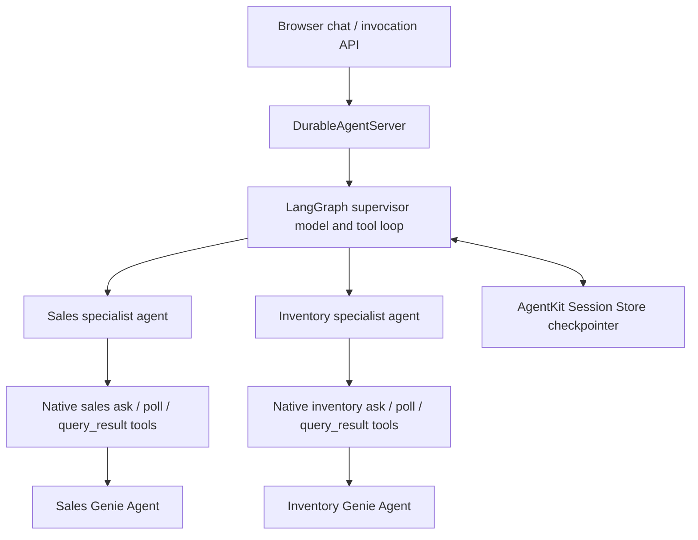

# Northstar Retail: LangGraph supervisor over two Genie Agents

A custom Python supervisor delegates to **two separately curated Genie Agents**: sales and inventory. Ask “Which best-selling products are below their reorder point?” and the supervisor can consult both domains, match `product_id`, and synthesize an evidence-backed recommendation. This is pro-code orchestration, not a managed Agent Bricks Supervisor resource.

The two space IDs in `agent.toml` are deliberately nonexistent examples. Bind Genie Agents created in your workspace before running or deploying. A binding is configuration, not proof of a successful Genie call.



The explicit `StateGraph` is in `agent/supervisor.py`. Its model chooses delegation tools; the `ToolNode` executes them and returns results to the supervisor. Each specialist is a LangChain `create_agent` graph with only its own native Genie tool triple. `genie_tools()` loads real bindings from `agent.toml`; no hand-written REST adapter or fabricated answers are used in application code. The underlying adapter calls `WorkspaceClient.genie.start_conversation`, `get_message`, and `get_message_attachment_query_result`, offloading synchronous SDK calls to threads. [Genie API](https://docs.databricks.com/aws/en/genie-agents/conversation-api), [LangGraph agent loops](https://docs.langchain.com/oss/python/langgraph/workflows-agents).

## Shared synthetic domain and setup

Use the SQL fixture and Genie configuration assets in [lower-code/genie-agents](../../lower-code/genie-agents/README.md). Its renderers put the fixture SQL and Genie configuration in a catalog and schema you choose in the target workspace. They define:

- Sales table (default `northstar_demo.retail.sales`): one sale row, with date, product ID/name, category, region, units, and net revenue in USD.
- Inventory table (default `northstar_demo.retail.inventory`): inventory snapshot by product and warehouse, with on-hand quantity and reorder point.
- Sales period October 1–3, 2026; inventory snapshot October 3, 2026. SKU-100 Trail Runner, SKU-200 City Pack, SKU-300 Rain Shell.

The fixture's definitions are synthetic demo conventions, not inferred business rules. Read and review the shared setup before executing any SQL or creating Genie resources. Validate the candidate SQL in your target workspace. For production reusable metrics, consider governed metric views and validate all KPI definitions with the data owner.

The required Genie creation SDK is `WorkspaceClient().genie.create_space(warehouse_id=..., serialized_space=..., title=..., description=..., parent_path=...)`; `serialized_space` is a JSON **string**, not a dict. SDK/CLI resource APIs still call these “spaces.” Creation/configuration belongs to the lower-code example; binding and orchestration belong here. [Genie creation and management](https://docs.databricks.com/aws/en/genie-agents/conversation-api).

## Offline checks — safe to run without a workspace

From this directory, install dependencies and run:

```bash
uv sync --frozen
uv run --frozen pytest -q
```

These tests inject model responses and SDK clients. They verify both-domain delegation, specialist tool isolation, actual SDK adapter submission and result extraction, session/recovery translation, and generated runtime/UI behavior. They **do not** prove that a live model selects the correct domain or generates correct SQL. Live tests require explicit `RUN_LIVE_TESTS=1`; merely having credentials does not enable them.

## Bind Genie Agents and deploy

First create and validate the fixture tables and the sales and inventory Genie Agents using the shared lower-code README. Record the two returned space IDs. Install the project (`uv sync --frozen`). Bind the IDs into this local manifest:

```bash
uv run --frozen python bind_genie.py \
  --sales-space-id '<sales-space-id>' \
  --inventory-space-id '<inventory-space-id>'
uv run --frozen agentbricks doctor .
```

The helper changes only the two `space_id` values and checks that the manifest remains valid TOML. It avoids rewriting this multi-tool manifest through `tools add genie-agent`. Names `sales` and `inventory` are integration contracts: the specialist code selects each corresponding ask/poll/query_result triple. Genie One is a different cross-workspace data discovery offering.

`--auth app` deliberately uses application credentials. For a future deployment, the app principal needs access to both Genie Agents, their SQL warehouse, and their underlying UC data. Local calls use the selected developer profile. An `actor` field or a session ID is not a data authorization boundary. The generated request-user client plumbing is retained, but adopting `--auth user` requires a deliberate identity/UI integration review and review of background/recovery limits; it is not validated by this demo. [Genie authentication prerequisites](https://docs.databricks.com/aws/en/genie-agents/conversation-api), [Agent Server authorization and recovery](https://docs.databricks.com/aws/en/agents/deploy/agent-server).

For a local run:

```bash
cp .env.example .env
# Replace YOUR_PROFILE in .env with the target workspace profile.
uv run --frozen agentbricks --profile '<profile>' dev --app-port 8002
```

`dev` hosts locally but model and Genie calls still reach Databricks. CLI 0.7.0 uses local invocation state, process-local conversation checkpoints and local tracing; bound managed stores are not provisioned or used by `dev`. To use **existing** managed stores locally instead, supply `AGENT_SESSION_STORE` and `AGENT_MEMORY_STORE` through `.env` and run `uv run --frozen start-server` directly.

After local verification, choose a unique App name and review the Session Store, Memory Store, and tracing names in `agent.toml` for the target workspace. To deploy the bound agent:

```bash
uv run --frozen agentbricks --profile '<profile>' deploy '<app-name>' --source .
databricks apps get 'agent-bricks-<app-name>' --profile '<profile>'
```

The deploy command provisions or binds resources declared in the manifest and creates or updates a Databricks App with the `agent-bricks-` prefix. Keep `<app-name>` to 17 characters so the full App name fits the 30-character limit. Deployment reconciles Genie Agent grants, but it does **not** grant Unity Catalog data access. Read the App's `service_principal_client_id` from `databricks apps get`; grant that principal `USE CATALOG` on your catalog, `USE SCHEMA` on your demo schema, and `SELECT` on the two fixture tables. Verify the deployed response and trace; App readiness alone does not prove that Genie calls worked.

The default gateway model is `system.ai.claude-sonnet-4-5`, inherited from the installed template. Access to that model has not been validated; choose an available tool-capable gateway model through the UI or `input.model`. [Agent Bricks CLI](https://docs.databricks.com/aws/en/agents/custom-agents/agent-bricks-cli).

## Example request and inspection

Once a live local server has deliberately been started, use the browser at `http://localhost:8002`, or:

```bash
curl -sS http://localhost:8002/api/invocations \
  -H 'Content-Type: application/json' \
  -d '{
    "id": "22222222-2222-4222-8222-222222222222",
    "session_id": "retail-analysis-1",
    "input": {
      "messages": [{"role": "user", "content": "Compare sales by product from 2026-10-01 through 2026-10-03 with the 2026-10-03 stock snapshot. Which products are below their reorder point? Cite the evidence from both Genie Agents."}]
    }
  }'
```

Retain `session_id` for follow-ups and use a fresh invocation UUID every request. Use globally unique session IDs and authorize ownership server-side before accepting a request; never let an unrelated actor reuse another actor's session ID. AgentKit's saver resolves/caches sessions by the derived thread ID, while the process-local saver also keys by thread. Merely changing actor does not isolate a reused session ID. The top-level invocation session is the LangGraph thread; `DEMO_ACTOR_ID` (default `agent`) controls the managed-state actor; `input.actor` is ignored. The UI uses the same fixed actor and ignores actor browse/search overrides. This sample is deliberately single-user/team; its UI and session IDs are not a multi-user authorization system. Application authentication must establish trusted identity before production use. The server handles async scheduling and event transport; graph/model/tool calls use `await`.

For live acceptance, inspect trace/tool events for both `sales_specialist` and `inventory_specialist`, actual Genie ask calls, fetched result rows, and deep links. Compare generated SQL/results with the shared fixture's reviewed SQL. Also check sales-only and inventory-only questions, an ambiguous date, an unavailable domain, and a Genie failure.

## CLI vs SDK/code

| Concern | Change here |
| --- | --- |
| Bind an existing curated Genie Agent | CLI `tools add genie-agent ... --name sales/inventory --auth app` → `agent.toml` |
| Create/curate Genie Agents and tables | Shared lower-code sample, Databricks SDK/CLI assets; never done on import |
| Domain routing and synthesis | Python `agent/supervisor.py`, prompts, model and tools |
| Attach conversation persistence | CLI `sessions bind <store>` plus existing AgentKit `checkpointer()`/`thread_config()` wiring |
| Attach optional direct memory tools | CLI `memory bind <store>` plus existing actor-scoped `memory_tools(actor)` wiring |
| Runtime protocol and recovery | Generated `runtime/adapter.py` and `runtime/main.py`; retained rather than replaced |

The store names in the manifest are declarations for later deployment. This sample focuses on orchestration. LangGraph serialized checkpoints are not pipeline-readable conversations: automatic extraction needs an additional readable transcript in the Session Store. No memory pipeline is declared or implied here. [Session and memory tutorial](https://docs.databricks.com/aws/en/agents/agent-memory/existing-agent-tutorial).

## Execution limits and recovery

Each delegation starts a fresh specialist context and Genie conversation. The supervisor preserves conversation history and passes relevant context in the next self-contained question. Subagents do not persist independent cross-turn histories. A specialist returns a summary including SQL/deep links rather than exporting every raw row to the supervisor. SQL result adapters cap returned rows at 100 and flag truncation.

The supervisor has a bounded LangGraph recursion limit (25 by default); specialists cap at 20. Pending/failed Genie queries must be surfaced, never treated as completed results. The templates preserve synchronous checkpoint durability and invocation-associated recovery. Recovery is at least once: a delegation interrupted before its checkpoint can submit another read-only Genie query and incur additional compute. There is no exactly-once query guarantee. No ordering or replenishment write tool is exposed. [Agent Server durability](https://docs.databricks.com/aws/en/agents/deploy/agent-server).

Verified October 26, 2026 against installed `databricks-agentbricks==0.7.0`, `databricks-langchain==0.21.0`, their `genie_tools`/`GenieAgent` source, generated `AGENTKIT_CONTRACT.md`, SDK method signatures and the linked official documentation. Perform the workspace checks above in each target workspace; a local pass does not validate model, Genie, store permission or recovery behavior there.

Dependency resolution uses pinned Agent Bricks 0.7.0, databricks-langchain 0.21.0 and SDK 0.157.0. A complete `uv.lock` is included. Offline tests pass in this sample's separately synced environment using `uv run --frozen pytest -q`.
