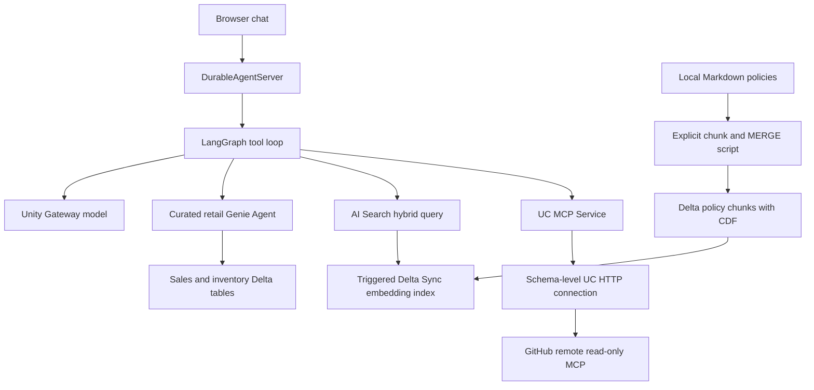

# Northstar Retail: Genie + AI Search + external MCP

A browser chat and LangGraph agent on Agent Bricks 0.7.0, with three integrations:

| Question | Integration | Evidence |
| --- | --- | --- |
| Sales and inventory | Curated Genie Agent through AgentKit native conversation tools | SQL, query rows, conversation/message/attachment IDs |
| Returns, shipping, replenishment | AI Search hybrid retrieval through Workspace SDK | Source URI, chunk ID, retrieved text |
| Engineering implementation | External GitHub MCP through UC HTTP connection and MCP Service | Repository file paths and links |

GitHub MCP is optional and has not been validated with a live credential.



Nothing in application startup creates external resources. The active manifest
has no invented Genie ID or external service binding. Setup scripts default to
**offline preview**; `--apply` and a chosen profile are required to mutate a
workspace.

## Code map

- `agent/agent.py`: generated AgentKit wiring, LangGraph agent construction,
  checkpoints, streaming and recovery. LangChain `create_agent` returns a
  LangGraph graph, following the installed LangGraph scaffold.
- `agent/prompt.py`: source routing, citations and no fabricated answers.
- `agent/tools/policy_search.py`: async retrieval with blocking SDK calls offloaded
  via `asyncio.to_thread`; column names come from the returned result manifest.
- `agent/mcps.py`: generated MCP extension point. `mcp_tools` loads declared
  services; no direct GitHub call bypasses the governed service.
- `runtime/`, `ui/`: generated invocation server and browser/state APIs.
- `scripts/`: explicit ingestion, index lifecycle and connection/MCP registration.
- `data/policies/`: synthetic policies with `northstar-policy://` citations.
- `resources/agent.bindings.toml.example`: deliberately inactive binding example.

## Offline validation

From the repository root:

```bash
cd pro-code/06-retail-assistant
uv sync --frozen
uv run --frozen pytest
uv run --frozen python -m scripts.ingest_policies
uv run --frozen python -m scripts.create_search_index
uv run --frozen python -m scripts.register_mcp
uv run --frozen agentbricks doctor .
```

Tests inject clients and model/tool outcomes; they do not verify live Genie,
embeddings, GitHub credentials or permissions. Live model testing is disabled
unless `RUN_LIVE_TESTS=1` is explicitly set. Keep it unset during offline review.

## Resource setup in a target workspace

Choose your profile and UC names before applying. Prerequisites: existing
catalog/schema, SQL warehouse, supported AI Search region and available
embedding model. Scripts never auto-select a workspace or warehouse.
If needed, create the profile with
`databricks auth login --host <workspace-url> --profile YOUR_PROFILE`.

### 1. Tabular data and curated Genie

Use the shared fixtures and Genie setup under `../../lower-code/genie-agents/`
(see its README for exact entrypoints). Choose one existing catalog and a dedicated
schema in the target workspace; pass that catalog/schema to both lower-code renderers
and every script below. Use simple lowercase names because the MCP registration
script validates them. The default names are
`northstar_demo.retail.sales` and `northstar_demo.retail.inventory`, covering
October 1–3, 2026 and an October 3 inventory snapshot. For mixed inventory prompts,
configure a **retail Genie Agent containing both tables**. Use the combined
`retail.serialized-space.json` asset there: from the lower-code directory,
`uv run --frozen python render_request.py retail --catalog YOUR_CATALOG --schema YOUR_SCHEMA --warehouse-id YOUR_WAREHOUSE_ID` renders
its create request offline. Its CTE examples preaggregate sales before joining
inventory and scope stock to one snapshot date. Follow the lower-code README to
review and explicitly create that resource later. Sample 04's sales-only Genie
answers only sales prompts.

From this project directory, bind an existing retail Genie ID:

```bash
cd "$(git rev-parse --show-toplevel)/pro-code/06-retail-assistant"
uv run --frozen agentbricks --profile YOUR_PROFILE tools add genie-agent YOUR_REAL_GENIE_ID --name retail --auth app
```

The installed command is `genie-agent`, not `genie`. It writes a `genie_agent`
binding with `source.space_id`; AgentKit builds `retail_ask`, `retail_poll`, and
`retail_query_result`. The model cannot choose another space or credentials.
This is a curated Genie Agent, not Genie One discovery. `ask` may return pending;
poll and fetch query rows before treating SQL text as executed evidence.

### 2. Unstructured ingestion and AI Search

Preview, then explicitly ingest the small demo documents:

```bash
uv run --frozen python -m scripts.ingest_policies --table YOUR_CATALOG.YOUR_SCHEMA.policy_chunks
uv run --frozen python -m scripts.ingest_policies --table YOUR_CATALOG.YOUR_SCHEMA.policy_chunks --profile YOUR_PROFILE --warehouse-id YOUR_WAREHOUSE_ID --apply
```

The utility creates a CDF-enabled Delta source and MERGEs parameterized chunks
by stable source/offset IDs. Re-running unchanged documents is idempotent. It
does not delete stale chunks when documents shrink or disappear; use a versioned
source table or explicitly reconcile removed IDs for those changes.

Create an endpoint only if a suitable one does not already exist:

```bash
uv run --frozen python -m scripts.create_search_index --action endpoint --endpoint YOUR_ENDPOINT --profile YOUR_PROFILE --apply
databricks vector-search-endpoints get-endpoint YOUR_ENDPOINT --profile YOUR_PROFILE
```

Wait for ONLINE, then create the index:

```bash
uv run --frozen python -m scripts.create_search_index --action index --endpoint YOUR_ENDPOINT --index YOUR_CATALOG.YOUR_SCHEMA.policy_index --table YOUR_CATALOG.YOUR_SCHEMA.policy_chunks --profile YOUR_PROFILE --apply
databricks vector-search-indexes get-index YOUR_CATALOG.YOUR_SCHEMA.policy_index --profile YOUR_PROFILE
```

The TRIGGERED Delta Sync index uses `databricks-gte-large-en` managed embeddings
and syncs citation columns. Wait for readiness. After later source changes,
synchronize explicitly and check readiness again:

```bash
uv run --frozen python -m scripts.create_search_index --action sync --index YOUR_CATALOG.YOUR_SCHEMA.policy_index --profile YOUR_PROFILE --apply
```

Set `POLICY_INDEX_NAME` to the real index. AI Search is the current product name;
SDK/CLI retain `vector_search_indexes` / `vector-search-indexes`. Document
ingestion/indexing is independent of Agent Bricks memory pipelines.

### 3. External MCP through an HTTP connection

The concrete provider is GitHub's hosted **read-only** MCP endpoint,
`https://api.githubcopilot.com/mcp/readonly`. Use a real bearer token allowed to
read your intended repositories. Check provider/account policies and remote MCP
availability before running. No credentials are bundled. This example uses a
UC-managed bearer credential, not Databricks-managed per-user OAuth.

```bash
uv run --frozen python -m scripts.register_mcp --schema YOUR_CATALOG.YOUR_SCHEMA
# Supply MCP_SERVER_TOKEN securely in the environment before applying.
uv run --frozen python -m scripts.register_mcp --schema YOUR_CATALOG.YOUR_SCHEMA --profile YOUR_PROFILE --apply
uv run --frozen agentbricks --profile YOUR_PROFILE tools add mcp YOUR_CATALOG.YOUR_SCHEMA.github_docs --name github_docs --auth app
```

The SDK script creates two distinct resources under the chosen catalog/schema:

1. HTTP connection: `parent=schemas/<catalog>.<schema>`, host/port/base path,
   bearer credential stored in UC.
2. MCP Service: `source_connection.name=connections/<catalog>.<schema>.github_readonly`,
   with `get_file_contents` and `search_code` as its only exposed tools.

AgentKit discovers the service tools and supplies them to the model and executor
on the next graph construction. Its URL is
`https://WORKSPACE_HOST/ai-gateway/mcp-services/<catalog>.<schema>.github_docs`.
It uses neither legacy `is_mcp_connection=true` nor `/api/2.0/mcp/external/...`.

If connection creation succeeds but service creation fails, inspect and reuse
the existing connection in a reviewed repair. The script does not overwrite
resources, roll back or swallow the error. Registration does not prove tool use.

## Permissions and configuration ownership

| Resource | Setup/runtime access |
| --- | --- |
| Genie | Runtime principal needs access to the Genie Agent; configure SQL warehouse and data access under its security model |
| Policy source/index | Setup needs parent UC privileges, source-table write/CDF and AI Search creation permissions; runtime needs `USE CATALOG`, `USE SCHEMA`, `SELECT` on the index |
| Embeddings | Index setup identity needs permission to query the embedding endpoint |
| Connection/MCP | Registration needs parent use privileges, schema `CREATE CONNECTION` and `CREATE SERVICE` (or existing connection `USE CONNECTION`); runtime needs parent use privileges and MCP Service `EXECUTE` |
| Sessions/memory | Manifest declares intent; Agent Bricks provisions and grants access during deployment; default `dev` uses local state |

CLI tool commands own Genie/MCP manifest bindings. `mcp_tools()` and
`genie_tools()` own native framework integration. Our code owns prompts, citation
retrieval and AI Search ingestion/lifecycle. **The custom Python AI Search tool
is not an `agent.toml` binding**: explicitly configure its grants and
`POLICY_INDEX_NAME` when deploying. The CLI does not infer
those dependencies from Python source.

`auth=app` provides shared read-only tool access here. `auth=user` requires the
generated request-user authorization and request-scoped client path. Actor IDs
group state; they are not authorization boundaries. This single-user/team demo
uses server-owned `DEMO_ACTOR_ID` (default `agent`), ignoring payload actor values,
forwarded identity headers and UI memory actor overrides. This is not production
authentication or tenant isolation. Session IDs are still supplied by clients;
implement trusted per-user identity and session ownership before multi-user use.

## Run the full stack

After setup/grants are reviewed, copy `.env.example` to `.env`, replace `YOUR_PROFILE`
and `YOUR_CATALOG.YOUR_SCHEMA.policy_index`, then start locally:

```bash
cp .env.example .env
uv run --frozen agentbricks --profile YOUR_PROFILE dev
```

`agentbricks dev` starts the browser at
`http://localhost:8000`. **Model and configured tool calls are live**. In installed
0.7.0, default `dev` keeps tracing in a local SQLite-backed MLflow server, memory
off and session history in process; it does not provision the declared managed
stores.

After local verification, review the Session Store, Memory Store, and tracing
names in `agent.toml` for the target workspace. Add the index name to `app.yaml`
and grant the App service principal access to it. The CLI cannot infer this
Python tool dependency:

```yaml
env:
  - name: POLICY_INDEX_NAME
    value: YOUR_CATALOG.YOUR_SCHEMA.policy_index
```

Choose a unique agent name and deploy. The CLI prefixes the resulting App name
with `agent-bricks-`:

```bash
uv run --frozen agentbricks --profile YOUR_PROFILE deploy YOUR_AGENT_NAME --source .
databricks apps get agent-bricks-YOUR_AGENT_NAME --profile YOUR_PROFILE
```

Attach the policy index and both Genie source tables to the App service
principal. This preserves the Genie and tracing resources that deployment added:

```bash
uv run --frozen python -m scripts.grant_app_access --profile YOUR_PROFILE --app agent-bricks-YOUR_AGENT_NAME --schema YOUR_CATALOG.YOUR_SCHEMA
uv run --frozen python -m scripts.grant_app_access --profile YOUR_PROFILE --app agent-bricks-YOUR_AGENT_NAME --schema YOUR_CATALOG.YOUR_SCHEMA --apply
```

The command expects `sales`, `inventory`, and `policy_index` in that schema. Run
it again after redeployment if the App's resource list changes.

Verify the deployed agent with a new invocation UUID:

```bash
uv run --frozen agentbricks --profile YOUR_PROFILE endpoint invoke agent-bricks-YOUR_AGENT_NAME \
  --path /api/invocations \
  --json '{"id":"11111111-1111-4111-8111-111111111111","session_id":"retail-demo-1","input":{"messages":[{"role":"user","content":"Can a Rain Shell be returned after 20 days? Search the policy and cite the relevant passage."}]},"stream":false}'
```

Example prompts and evidence to inspect:

- “Which product had the highest net revenue October 1–3, 2026? Fetch query rows.”
  → actual Genie ask/result calls.
- “Can a Rain Shell be returned after 20 days?” → policy search source/chunk citation.
- “Which warehouse/product rows need replenishment review? Include the snapshot.”
  → Genie **and** policy search.
- “Use GitHub MCP to read README.md from owner/repository and explain how its
  ingestion supports our retail policy pipeline.” → governed `get_file_contents`
  call; substitute a real authorized repository.

GitHub MCP has not been validated in a live workspace. It requires a configured
GitHub credential before running that prompt.

Inspect browser tool events and MLflow traces. A plausible answer, binding or
mocked test does not establish live integration success. Managed sessions and
explicit actor-scoped memory tools remain wired. For automatic memory extraction
and transcript recording, see the [Session and memory tutorial](https://docs.databricks.com/aws/en/agents/agent-memory/existing-agent-tutorial);
checkpoint blobs alone are not an extraction-ready transcript.

## Sources and validation scope

API shapes were checked against installed `databricks-agentbricks==0.7.0`,
`databricks-langchain==0.21.0`, and `databricks-sdk==0.157.0` source and CLI help.
Official references:

- [Agent Bricks CLI](https://docs.databricks.com/aws/en/agents/custom-agents/agent-bricks-cli)
- [LangChain agents on LangGraph](https://docs.langchain.com/oss/python/langchain/agents)
- [Create AI Search indexes](https://docs.databricks.com/aws/en/ai-search/create-ai-search)
- [AI Search query permissions](https://docs.databricks.com/aws/en/ai-search/query-ai-search)
- [External MCP registration](https://docs.databricks.com/aws/en/ai-gateway/register-mcp-service)
- [MCP SDK reference](https://docs.databricks.com/aws/en/ai-gateway/mcp-service-reference)
- [HTTP connections](https://docs.databricks.com/aws/en/query-federation/http)
- [GitHub remote MCP](https://github.com/github/github-mcp-server/blob/main/docs/remote-server.md)

Workspace availability, auth, permissions, embeddings, tool discovery, SQL,
index readiness and end-to-end calls must be validated in each target workspace.
[AGENTKIT_CONTRACT.md](AGENTKIT_CONTRACT.md) and
[CHAT_APP.md](CHAT_APP.md) explain generated runtime/browser contracts.
